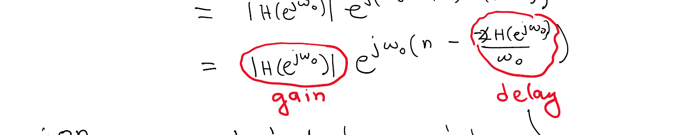
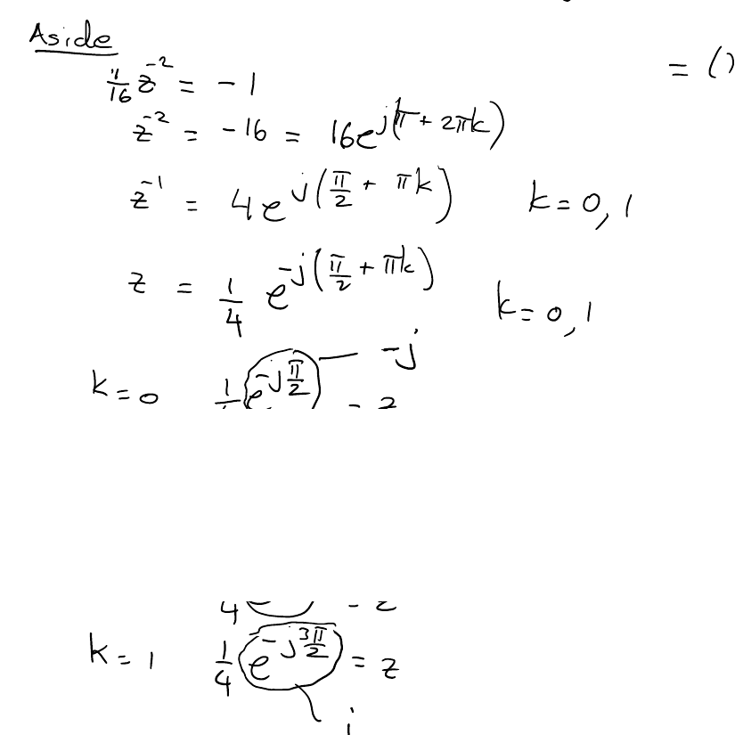
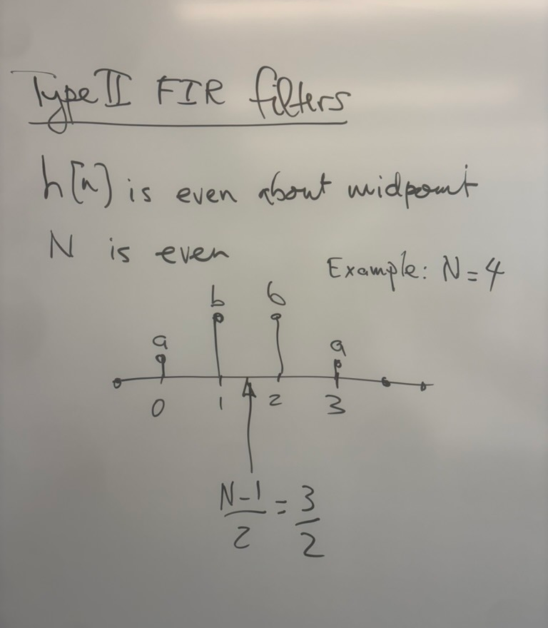
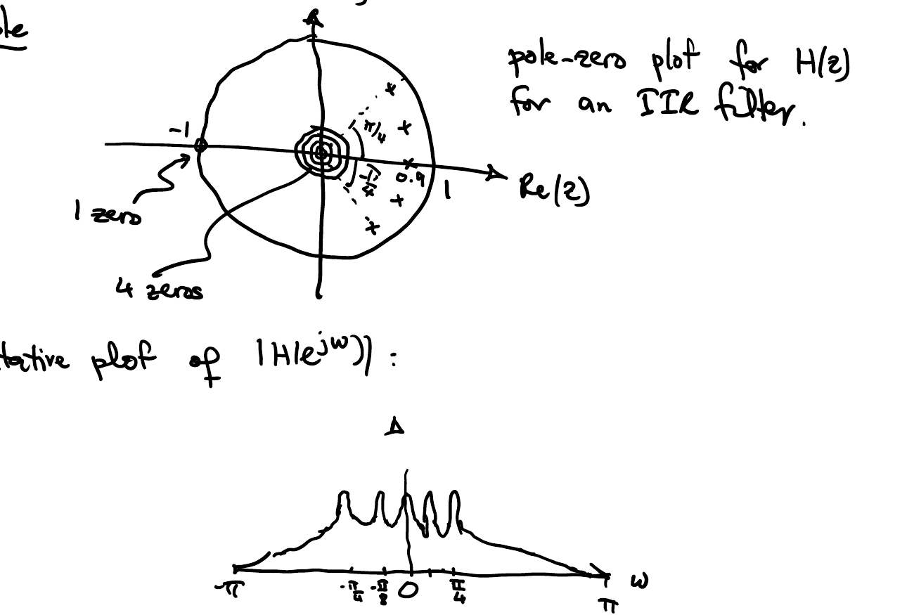
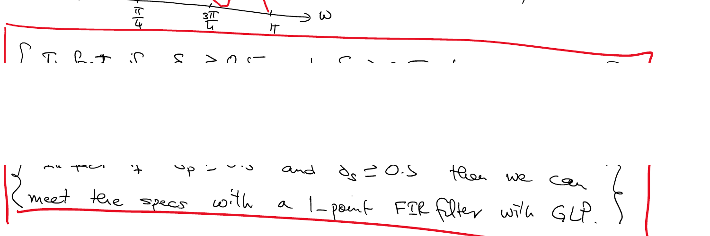

# EC516: Digital Signal Processing — Lecture Notes

Transcribed from handwritten notes (Lectures 01–13). Sections marked **Unclear part** include a screenshot of the original handwriting for reference; screenshots are in the `OneNoteScreenshots/` folder next to this file.

## Contents

- [Lecture 01](#lecture-01)
- [Lecture 02](#lecture-02)
- [Lecture 03](#lecture-03)
- [Lecture 04](#lecture-04)
- [Lecture 05](#lecture-05)
- [Lecture 06](#lecture-06)
- [Lecture 07](#lecture-07)
- [Lecture 08](#lecture-08)
- [Lecture 09](#lecture-09)
- [Lecture 10](#lecture-10)
- [Lecture 11](#lecture-11)
- [Lecture 12](#lecture-12)
- [Lecture 13](#lecture-13)

---

## Lecture 01

*Wednesday, September 2, 2026*

### EC516: DSP

**Convolution:**

$$x[n] * h[n] = y[n]$$

**Multiplication:**

$$x[n] \times h[n] = g[n]$$

$$x[n-n_0] \times h[n-n_0] = g[n-n_0]$$

**However:**

$$x[n-n_0] * h[n-n_0] = y[n-2n_0]$$

> Because LTI systems perform convolution.

```text
x[n] ──► [ LTI ] ──► y[n] = x[n] * h[n]
           h[n]  (impulse response)
```

**TI (time invariance):**

$$x[n-n_0] \rightarrow \boxed{\text{LTI},\ h[n]} \rightarrow y[n-n_0] = x[n-n_0] * h[n]$$

#### Convolution is commutative

$$x[n] * h[n] = h[n] * x[n]$$

```text
x[n] ──► [ LTI: h[n] ] ──► y[n]        h[n] ──► [ LTI: x[n] ] ──► y[n]
```

e.g. if $y[n] = x[n] * h[n]$, then

$$y[n] = x[n-3] * h[n+3]$$

$$y[n-2] = x[n-7] * h[n+5]$$

#### Mechanics of Convolution for DSP

```text
x[n] ──► [ LTI: h[n] ] ──► y[n]
δ[n] ──► [ LTI ] ──► h[n]
```

($\delta[n]$: a single sample of height 1 at $n = 0$.)

| Input | | Output | Reason |
|---|---|---|---|
| $\delta[n-k]$ | → LTI → | $h[n-k]$ | LTI is **Time Invariant** |
| $x[k]\ \delta[n-k]$ | → LTI → | $x[k]\ h[n-k]$ | because of the **scaling property** |
| $\displaystyle\sum_{k=-\infty}^{\infty} x[k]\ \delta[n-k]$ | → LTI → | $\displaystyle\sum_{k=-\infty}^{\infty} x[k]\ h[n-k]$ | **additivity property** |

The input sum on the left is just $x[n]$, and the output sum on the right is $x[n] * h[n] = y[n]$.

$$y[n] = \sum_{k=-\infty}^{\infty} x[k]\ h[n-k] = \boxed{\sum_{k=-\infty}^{\infty} h[k]\ x[n-k]}$$

- The equality holds because **convolution is commutative**.
- The boxed expression is the **standard form of the convolution sum** — a *sum of echoes of the input signal*.
- Important for performing the "mechanics" of convolution in DSP.

#### Example

```text
x[n] ──► [ LTI: h[n] ] ──► y[n]
```

Say

$$x[n] = \delta[n+1] + 2\ \delta[n] - \delta[n-1] \qquad \text{(i.e. } x[-1]=1,\ x[0]=2,\ x[1]=-1\text{)}$$

$$h[n] = u[n] \qquad \text{(1 for } n \ge 0\text{)}$$

$$y[n] = \sum_{k=-\infty}^{\infty} h[k]\ x[n-k] = \sum_{k=0}^{\infty} h[k]\ x[n-k]$$

$$y[n] = \sum_{k} x[k]\ h[n-k] = \sum_{k=-1}^{1} x[k]\ h[n-k]$$

$$= x[0]\ h[n] + x[1]\ h[n-1] + x[-1]\ h[n+1]$$

$$= 2\ h[n] + (-1)\ h[n-1] + (1)\ h[n+1]$$

Stacking the three shifted, scaled copies of $h[n]$ and adding column by column:

| $n$ | -1 | 0 | 1 | 2 | 3 | 4 | 5 | … |
|---|---|---|---|---|---|---|---|---|
| $(1)\ h[n+1]$ | 1 | 1 | 1 | 1 | 1 | 1 | 1 | … |
| $2\ h[n]$ | 0 | 2 | 2 | 2 | 2 | 2 | 2 | … |
| $(-1)\ h[n-1]$ | 0 | 0 | -1 | -1 | -1 | -1 | -1 | … |
| $y[n]$ | **1** | **3** | **2** | **2** | **2** | **2** | **2** | … |

#### Convolution Becomes Multiplication in Frequency Domain

$$e^{j\omega_0 n} \rightarrow \boxed{\text{LTI},\ h[n]} \rightarrow y[n] = \sum_{k=-\infty}^{\infty} h[k]\ e^{j\omega_0 (n-k)}$$

$$= e^{j\omega_0 n} \underbrace{\left( \sum_{k=-\infty}^{\infty} h[k]\ e^{-j\omega_0 k} \right)}_{\text{constant with respect to } n}$$

> **LTI systems *preserve* frequency.**

---

## Lecture 02

*Wednesday, September 9, 2026*

$$x[n] = e^{j\omega_0 n} \rightarrow \boxed{\text{LTI},\ h[n]} \rightarrow y[n] = \sum_{k=-\infty}^{\infty} h[k]\ e^{j\omega_0 (n-k)} = \underbrace{H(e^{j\omega_0})}_{\text{number (complex)}} e^{j\omega_0 n}$$

$$H(e^{j\omega_0}) = \sum_{k=-\infty}^{\infty} h[k]\ e^{-j\omega_0 k}$$

Euler:

$$e^{j\omega_0 n} = \cos \omega_0 n + j \sin \omega_0 n$$

$$\cos \omega_0 n = \frac{1}{2} e^{j\omega_0 n} + \frac{1}{2} e^{-j\omega_0 n}$$

$$\sin \omega_0 n = \frac{1}{2j} e^{j\omega_0 n} - \frac{1}{2j} e^{-j\omega_0 n}$$

Gain and delay:

$$H(e^{j\omega_0})\ e^{j\omega_0 n} = \underbrace{\left|H(e^{j\omega_0})\right| e^{j \angle H(e^{j\omega_0})}}_{H(e^{j\omega_0})} \cdot e^{j\omega_0 n}$$

$$= \left|H(e^{j\omega_0})\right| e^{j\left(\omega_0 n + \angle H(e^{j\omega_0})\right)}$$

$$= \underbrace{\left|H(e^{j\omega_0})\right|}_{\text{gain}}\ e^{j\omega_0 \left(n - \underbrace{\left(-\frac{\angle H(e^{j\omega_0})}{\omega_0}\right)}_{\text{delay}}\right)}$$

The delay can be a **fractional delay** (not an integer number of samples).

> **Unclear part:** the sign inside the delay term is hard to read. Lecture 07 writes the same result as $n - \left(-\angle H(e^{j\omega_0}) / \omega_0\right)$, which is what is used above.
>
> 

Two special frequencies:

$$e^{j0n} = 1 \qquad \text{(all samples equal to 1)}$$

$$e^{j\pi n} = (-1)^n \qquad \text{(samples alternate } +1, -1\text{)}$$

#### Drop $\omega_0$ for frequency variable $\omega$

$$H(e^{j\omega}) = \sum_{k=-\infty}^{\infty} h[k]\ e^{-j\omega k} = \text{Fourier transform of } h[n]$$

#### Example

$$x[n] = \delta[n] \longleftrightarrow X(e^{j\omega}) = 1 = e^{j0}$$

$$x[n] = e^{j\omega_0 n} \longleftrightarrow X(e^{j\omega}) = \sum_{k=-\infty}^{\infty} 2\pi\ \delta(\omega - \omega_0 - 2\pi k)$$

(impulses of area $2\pi$ at $\dots,\ \omega_0 - 4\pi,\ \omega_0 - 2\pi,\ \omega_0,\ \omega_0 + 2\pi,\ \dots$)

$X(e^{j\omega})$ is called the **DTFT** of $x[n]$.

#### Properties of DTFT

| # | Property | Time domain | Frequency domain |
|---|---|---|---|
| 1 | Periodicity | | $X(e^{j\omega}) = X(e^{j(\omega - 2\pi)})$ |
| 2 | Shift | $x[n-n_0]$ | $e^{-j\omega n_0}\ X(e^{j\omega})$ |
| 3 | Shift in freq. (dual of 2) | $e^{j\omega_0 n}\ x[n]$ | $X(e^{j(\omega - \omega_0)})$ |
| 4 | Flip | $x[-n]$ | $X(e^{-j\omega})$ |
| 5 | Linearity | $\alpha_1 x_1[n] + \alpha_2 x_2[n]$ | $\alpha_1 X_1(e^{j\omega}) + \alpha_2 X_2(e^{j\omega})$ |
| 6 | Convolution (in time) | $x[n] * h[n]$ | $X(e^{j\omega})\ H(e^{j\omega})$ |
| 7 | Convolution (in frequency) (dual of 6) | $x_1[n] \times x_2[n]$ (multiplication) | "Convolution" of $X_1(e^{j\omega})$ with $X_2(e^{j\omega})$: $\displaystyle\int_{-\pi}^{\pi} X_1(e^{j\theta})\ X_2(e^{j(\omega-\theta)})\ d\theta$ |

#### Example of DTFT Calculation

The "box" ("rectangular") signal:

$$x[n] = u[n] - u[n-N] \qquad \text{(1 for } 0 \le n \le N-1\text{)}$$

$$X(e^{j\omega}) = \sum_{n=-\infty}^{\infty} x[n]\ e^{-j\omega n} = \sum_{n=0}^{N-1} e^{-j\omega n} = \frac{1 - e^{-j\omega N}}{1 - e^{-j\omega}}$$

**Finite Sum Formula:**

$$\sum_{n=0}^{N-1} \alpha^n = \begin{cases} \dfrac{1 - \alpha^N}{1 - \alpha} & \text{provided } \alpha \ne 1 \\ N & \text{when } \alpha = 1 \end{cases}$$

**Aside — Infinite Sum Formula:**

$$\sum_{n=0}^{\infty} \alpha^n = \frac{1}{1 - \alpha} \qquad \text{provided } |\alpha| < 1$$

**Back to the "box":** (cute trick to remember — factor out the half-angle exponential)

$$X(e^{j\omega}) = \frac{1 - e^{-j\omega N}}{1 - e^{-j\omega}} = \frac{e^{-j\omega N/2} \left(e^{j\omega N/2} - e^{-j\omega N/2}\right)}{e^{-j\omega/2} \left(e^{j\omega/2} - e^{-j\omega/2}\right)}$$

$$= \frac{e^{-j\omega N/2} \left(e^{j\omega N/2} - e^{-j\omega N/2}\right) / 2j}{e^{-j\omega/2} \left(e^{j\omega/2} - e^{-j\omega/2}\right) / 2j}$$

$$= \underbrace{e^{-j\omega (N-1)/2}}_{\text{angle (phase)}} \cdot \underbrace{\left(\frac{\sin (N\omega/2)}{\sin (\omega/2)}\right)}_{\text{magnitude: real valued but not positive everywhere}}$$

#### z-transform

A generalization of the Fourier transform that can be used on **unstable** systems.

For signal $x[n]$ we define its z-transform as

$$X(z) = \underbrace{\sum_{n=-\infty}^{\infty} x[n]\ z^{-n}}_{\text{algebraic expression}}$$

for a **region of convergence (ROC)** specifying values of $|z|$ for which the algebraic expression holds (converges).

**Note:** $X(e^{j\omega})$ is the same as $X(z)$ evaluated at $z = e^{j\omega}$, provided $|z| = 1$ is in the ROC.

```text
           Im(z)
             j
          .-'''-.
        /         \
  -1 --|-----+-----|-- 1 ──► Re(z)      unit circle: |z| = 1
        \         /
          '-...-'
            -j
```

#### Example

$$x[n] = \left(\frac{1}{2}\right)^n u[n] \qquad \text{(samples } 1,\ 0.5,\ (0.5)^2,\ \dots\text{)}$$

$$X(z) = \sum_{n=-\infty}^{\infty} x[n]\ z^{-n} = \sum_{n=0}^{\infty} \left(\frac{1}{2}\right)^n z^{-n} = \sum_{n=0}^{\infty} \left(\frac{1}{2} z^{-1}\right)^n$$

$$= \frac{1}{1 - \frac{1}{2} z^{-1}} \qquad \text{provided } \underbrace{\left|\frac{1}{2} z^{-1}\right| < 1}_{\text{ROC}}$$

ROC:

$$\frac{1}{2|z|} < 1 \quad \Rightarrow \quad |z| > \frac{1}{2}$$

---

## Lecture 03

*Monday, September 14, 2026*

**Last time:**

$$X(z) = \sum_{n=-\infty}^{\infty} x[n]\ z^{-n} \qquad \text{with ROC}$$

$$x[n] = \left(\frac{1}{2}\right)^n u[n] \longleftrightarrow X(z) = \frac{1}{1 - \frac{1}{2} z^{-1}}\ ;\quad |z| > \frac{1}{2}$$

The ROC includes the unit circle $\therefore$ $X(e^{j\omega})$ exists (converges).

#### Example

$$g[n] = -\left(\frac{1}{2}\right)^n u[-n+1]$$

(non-zero for $n \le 1$: $g[1] = -\tfrac{1}{2}$, $g[0] = -1$, $g[-1] = -2$, …)

$$G(z) = \sum_{n=-\infty}^{\infty} g[n]\ z^{-n} = -\sum_{n=-\infty}^{1} \left(\frac{1}{2}\right)^n z^{-n} = -\sum_{n=-\infty}^{1} \left(\frac{1}{2} z^{-1}\right)^n$$

Recall:

$$\sum_{n=0}^{\infty} \alpha^n = \frac{1}{1-\alpha} \qquad \text{provided } |\alpha| < 1$$

Substituting $n \rightarrow -n$:

$$G(z) = -\sum_{n=-1}^{\infty} \left(\frac{1}{2} z^{-1}\right)^{-n} = \underbrace{-\frac{1}{2} z^{-1}}_{n=-1} - \sum_{n=0}^{\infty} (2z)^n$$

$$= -\frac{1}{2} z^{-1} - \frac{1}{1 - 2z} \qquad \text{provided } |2z| < 1 \text{, i.e. } |z| < \frac{1}{2}$$

The ROC does **not** include the unit circle ($X(e^{j\omega})$ does not converge).

#### z-transform properties (of the algebraic expression)

| # | Property | Time domain | z-domain |
|---|---|---|---|
| 1 | Linear | $\alpha_1 x_1[n] + \alpha_2 x_2[n]$ | $\alpha_1 X_1(z) + \alpha_2 X_2(z)$ |
| 2 | Shift | $x[n-n_0]$ | $z^{-n_0}\ X(z)$ |
| 3 | Flip | $x[-n]$ | $X(z^{-1})$ |
| 4 | Conjugation | $x^*[n]$ | $X^*(z^*)$ |
| 5 | Convolution | $x[n] * h[n]$ | $X(z)\ H(z)$ |

#### z-transforms to be familiar with

$$\delta[n] \longleftrightarrow 1$$

$N$-pt. box:

$$u[n] - u[n-N] \longleftrightarrow \sum_{n=0}^{N-1} 1 \cdot z^{-n} = \sum_{n=0}^{N-1} z^{-n} = \boxed{\frac{1 - z^{-N}}{1 - z^{-1}}} \qquad \text{ROC: } |z| > 0$$

(using the finite sum formula $\sum_{n=0}^{N-1} \alpha^n = \frac{1 - \alpha^N}{1 - \alpha}$)

Decaying exponential:

$$\alpha^n u[n] \longleftrightarrow \frac{1}{1 - \alpha z^{-1}}\ ;\quad \text{ROC: } |z| > |\alpha|$$

The ROC includes the unit circle provided $|\alpha| < 1$.

#### Rational z-transforms

$X(z)$ is rational $\iff X(z) = \dfrac{N(z)}{D(z)}$ where $N(z)$ and $D(z)$ are **polynomials in $z$**.

**Example:**

$$X(z) = \frac{1}{1 - \frac{1}{2} z^{-1}} = \frac{1}{1 - \frac{1}{2} z^{-1}} \cdot \frac{z}{z} = \frac{z}{z - \frac{1}{2}} = \frac{N(z)}{D(z)}$$

We can factorize $N(z)$ and $D(z)$, cancel the common factors, and obtain $\dfrac{N'(z)}{D'(z)} = X(z)$. Then we define

- the **"zeros"** of $X(z)$ as the solutions to $N'(z) = 0$, and
- the **"poles"** of $X(z)$ as the solutions to $D'(z) = 0$.

> **NOTE:** Be careful about poles and/or zeros at $z = 0$ and $z = \infty$.
>
> **NOTE 2:** The # of poles = the # of zeros.

**Example:**

$$X(z) = \frac{1}{1 - \frac{1}{2} z^{-1}} = \frac{z}{z - \frac{1}{2}}$$

Zero at $z = 0$, pole at $z = \tfrac{1}{2}$; the ROC is the region outside the circle of radius $\tfrac{1}{2}$.

> **For right-sided signals, the ROC is always outside the outermost pole.**
>
> - *right-sided*: signal guaranteed zero before some finite time
> - *outermost pole*: the pole whose distance from the origin is the greatest
> - *outside*: outside a circle centered at the origin

**Example:** $x[n]$ is right-sided.

$$X(z) = \frac{1}{\left(1 + \frac{1}{4} z^{-2}\right)\left(1 - \frac{1}{8} z^{-1}\right)} = \frac{1}{\left(1 + \frac{1}{4} z^{-2}\right)\left(1 - \frac{1}{8} z^{-1}\right)} \cdot \frac{z^3}{z^3}$$

$$= \frac{z^3}{\left(z^2 + \frac{1}{4}\right)\left(z - \frac{1}{8}\right)}$$

- 3 zeros at $z = 0$
- 2 poles given by $z^2 + \frac{1}{4} = 0$
- 1 pole given by $z = \frac{1}{8}$

$$z^2 = -\frac{1}{4} \quad\Rightarrow\quad z^2 = \frac{1}{4} e^{j(\pi + 2\pi k)} \quad\Rightarrow\quad z = \frac{1}{2} e^{j\left(\frac{\pi}{2} + \pi k\right)}\ ,\quad k = 0, 1 \ \text{(square root)}$$

So the poles are at $\pm \frac{j}{2}$ and $\frac{1}{8}$.

$\therefore$ ROC is $|z| > \frac{1}{2}$ $\quad\therefore$ $X(e^{j\omega})$ converges.

#### Fourier Transform Convergence

**Dirichlet Conditions:**

$$X(e^{j\omega}) \text{ converges} \iff \underbrace{\sum_{n=-\infty}^{\infty} |x[n]| = \text{finite number}}_{x[n] \text{ is absolutely summable}}$$

#### Connection to LTI systems

```text
x[n] ──► [ LTI: h[n] ] ──► y[n]
```

> **LTI systems are stable $\iff$ $h[n]$ is absolutely summable.**

#### Terminology

| Symbol | Name |
|---|---|
| $h[n]$ | impulse response |
| $H(e^{j\omega})$ | frequency response |
| $H(z)$ | system function (transfer function) |

#### Example

LTI system with impulse response $h[n] = u[n] - u[n-4]$ (four samples of 1 at $n = 0, 1, 2, 3$). Stable?

$$\sum_{n=-\infty}^{\infty} |h[n]| = 4 \leftarrow \text{finite number} \quad \therefore \text{LTI system is stable}$$

**Alternatively:**

$$H(z) = \frac{1 - z^{-4}}{1 - z^{-1}} \times \frac{z^4}{z^4} = \frac{z^4 - 1}{z^3 (z - 1)}$$

Solve:

$$z^4 - 1 = 0 \quad\Rightarrow\quad z^4 = e^{j(0 + 2\pi k)} \quad\Rightarrow\quad z = e^{j\left(\frac{2\pi k}{4}\right)}\ ,\quad k = 0, 1, 2, 3$$

Zeros at $1,\ j,\ -1,\ -j$ on the unit circle; 3 poles at the origin; the zero at $z = 1$ cancels the pole at $z = 1$ (**pole-zero cancellation**).

ROC: $|z| > 0$

---

## Lecture 04

*Wednesday, September 16, 2026*

**Digital Filter (LTI):**

$$x[n] \rightarrow \boxed{h[n]} \rightarrow y[n] = \sum_{k=-\infty}^{\infty} h[k]\ x[n-k] = h[n] * x[n]$$

- $h[n] \longleftrightarrow H(e^{j\omega})$ — Frequency Response
- $h[n] \longleftrightarrow H(z)$ — System Function

**What a filter does:** convolution.

**When is a filter *practical*:** when convolution can be performed via a **finite number of arithmetic operations per output sample** (# multiplications and # additions).

**Assumption throughout the course:** Filters are **causal** (simplifies the analysis).

$$h[n] = 0 \quad n < 0$$

$$y[n] = \sum_{k=0}^{\infty} h[k]\ x[n-k]$$

#### FIR Filters

$$h[n] = 0 \quad \text{for } n > N-1$$

$h[n]$ is an **$N$-point signal**: possible non-zero samples only at $n = 0, 1, \dots, N-1$.

It follows that

$$y[n] = \sum_{k=0}^{N-1} h[k]\ x[n-k]$$

$$y[n_0] = \underbrace{h[0]\ x[n_0] + h[1]\ x[n_0 - 1] + \dots + h[N-1]\ x[n_0 - N + 1]}_{N \text{ multiplications},\ N-1 \text{ additions (upper bounds)}}$$

$$y[n] = \sum_{k=0}^{N-1} \underbrace{h[k]}_{\text{stored coefficients}}\ x[n-k] \qquad \beta_k = h[k]\ ,\quad 0 \le k \le N-1$$

$$y[n] = \sum_{k=0}^{N-1} \beta_k\ x[n-k] \qquad \leftarrow \textbf{Non-Recursive Difference Equation}$$

- Always possible for any FIR filter.
- **Note:** FIR filters can also be described using **recursive** difference equations.

#### Example

4-point impulse response: $h[n] = 1,\ \tfrac{1}{2},\ \tfrac{1}{4},\ \tfrac{1}{8}$ at $n = 0, 1, 2, 3$.

Difference Eqn:

$$y[n] = x[n] + \frac{1}{2} x[n-1] + \frac{1}{4} x[n-2] + \frac{1}{8} x[n-3]$$

Take the z-transform of both sides:

$$Y(z) = X(z) + \frac{1}{2} z^{-1} X(z) + \frac{1}{4} z^{-2} X(z) + \frac{1}{8} z^{-3} X(z)$$

$$Y(z) = X(z) \left(1 + \frac{1}{2} z^{-1} + \frac{1}{4} z^{-2} + \frac{1}{8} z^{-3}\right)$$

**Important Note:** Since we are talking about a filter,

$$y[n] = x[n] * h[n] \ \Rightarrow\ Y(z) = X(z)\ H(z) \ \Rightarrow\ H(z) = Y(z) / X(z)$$

$$H(z) = 1 + \frac{1}{2} z^{-1} + \frac{1}{4} z^{-2} + \frac{1}{8} z^{-3} = \sum_{n=0}^{3} \left(\frac{1}{2} z^{-1}\right)^n \underset{\text{FSF}}{=} \frac{1 - \left(\frac{1}{2} z^{-1}\right)^4}{1 - \left(\frac{1}{2} z^{-1}\right)}$$

**ROC?**

$$H(z) = \frac{z^4 - \left(\frac{1}{2}\right)^4}{z^3 \left(z - \frac{1}{2}\right)}$$

Numerator $(= 0)$:

$$z^4 = \frac{1}{16} = \frac{1}{16} e^{j2\pi k} \ \Rightarrow\ z = \frac{1}{2} e^{j\frac{2\pi k}{4}} = \frac{1}{2} e^{j\frac{\pi k}{2}}\ ,\quad k = 0, 1, 2, 3$$

Zeros at $\pm\tfrac{1}{2}$ and $\pm\tfrac{j}{2}$; 3 poles at the origin; the zero at $z = \tfrac{1}{2}$ cancels the pole at $z = \tfrac{1}{2}$ (**pole-zero cancellation**).

**General Result:** For an FIR filter, all the poles are at the origin.

$\Downarrow$ ROC is $|z| > 0$ for all FIR filters

$\Downarrow$ All FIR filters are **stable**

$\Downarrow$ Frequency Response always converges

**Interesting Result:** FIR filters can be described using "recursive" difference equations.

In our example, $h[n] = 1,\ \tfrac{1}{2},\ \tfrac{1}{4},\ \tfrac{1}{8}$:

$$H(z) = \frac{1 - \frac{1}{16} z^{-4}}{1 - \frac{1}{2} z^{-1}} = \frac{Y(z)}{X(z)}$$

Cross-Multiply:

$$Y(z) - \frac{1}{2} z^{-1} Y(z) = X(z) - \frac{1}{16} z^{-4} X(z)$$

Inverse z-transform of both sides:

$$y[n] - \frac{1}{2} y[n-1] = x[n] - \frac{1}{16} x[n-4]$$

$$\Rightarrow \boxed{y[n] = \frac{1}{2} y[n-1] + x[n] - \frac{1}{16} x[n-4]} \quad \leftarrow \text{Recursive difference equation}$$

Compare with

$$y[n] = x[n] + \frac{1}{2} x[n-1] + \frac{1}{4} x[n-2] + \frac{1}{8} x[n-3]$$

**Are there other recursive difference eqns for the same filter?**

Yes, there are an infinite number of recursive difference eqns we could write for the same filter:

$$H(z) = \frac{1 - \frac{1}{16} z^{-4}}{1 - \frac{1}{2} z^{-1}} \times \frac{\left(1 - \alpha_1 z^{-1}\right)}{\left(1 - \alpha_1 z^{-1}\right)} \cdots \frac{\left(1 - \alpha_M z^{-1}\right)}{\left(1 - \alpha_M z^{-1}\right)} = \frac{Y(z)}{X(z)}$$

Cross-Multiply and take inverse z-transform to get a difference eqn that will include stored coefficients that depend upon the arbitrarily selected $\alpha_1, \alpha_2, \dots, \alpha_M$.

#### Example

$h[n] = 1,\ \tfrac{1}{2},\ \tfrac{1}{4},\ \tfrac{1}{8}$ at $n = 0, 1, 2, 3$:

$$H(z) = \left(1 + \frac{1}{2} z^{-1} + \frac{1}{4} z^{-2} + \frac{1}{8} z^{-3}\right) \underbrace{\left(\frac{1 - \frac{1}{2} z^{-1}}{1 - \frac{1}{2} z^{-1}}\right)}_{\text{fake pole-zero pair}}$$

$$= \frac{1 + \frac{1}{2} z^{-1} + \frac{1}{4} z^{-2} + \frac{1}{8} z^{-3} - \frac{1}{2} z^{-1} - \frac{1}{4} z^{-2} - \frac{1}{8} z^{-3} - \frac{1}{16} z^{-4}}{1 - \frac{1}{2} z^{-1}}$$

(the middle terms cancel)

$$= \frac{1 - \frac{1}{16} z^{-4}}{1 - \frac{1}{2} z^{-1}}$$

#### Infinite Impulse Response Filters (still causal)

Consider an LTI system (filter) such that

$$H(z) = \frac{1 - \frac{1}{2} z^{-1}}{1 + \frac{1}{16} z^{-2}} = \left(1 - \frac{1}{2} z^{-1}\right) \cdot \frac{1}{1 + \frac{1}{16} z^{-2}} = \left(1 - \frac{1}{2} z^{-1}\right) \cdot \frac{1}{(\quad)(\quad)}$$

**Aside** (poles):

$$\frac{1}{16} z^{-2} = -1$$

$$z^{-2} = -16 = 16 e^{j(\pi + 2\pi k)}$$

$$z^{-1} = 4 e^{j\left(\frac{\pi}{2} + \pi k\right)}\ ,\quad k = 0, 1$$

$$z = \frac{1}{4} e^{-j\left(\frac{\pi}{2} + \pi k\right)}\ ,\quad k = 0, 1$$

- $k = 0$: $z = \frac{1}{4} e^{-j\frac{\pi}{2}} = -\frac{j}{4}$
- $k = 1$: $z = \frac{1}{4} e^{-j\frac{3\pi}{2}} = \frac{j}{4}$

> **Unclear part:** the sign of the exponent in the line for $z$ (and the $k = 0$ / $k = 1$ results) is hard to read. The transcription above follows from $z = 1 / z^{-1}$; either way the two poles are at $\pm \tfrac{j}{4}$.
>
> 

*We will finish this next lecture!*

---

## Lecture 05

*Monday, September 21, 2026*

From last time, a causal infinite impulse response filter:

$$\boxed{H(z) = \frac{1 - \frac{1}{2} z^{-1}}{1 + \frac{1}{16} z^{-2}}} = \frac{\left(1 - \frac{1}{2} z^{-1}\right)}{\left(1 + \frac{j}{4} z^{-1}\right)\left(1 - \frac{j}{4} z^{-1}\right)} \times \frac{z^2}{z^2}$$

$$= \frac{z \left(z - \frac{1}{2}\right)}{\left(z + \frac{j}{4}\right)\left(z - \frac{j}{4}\right)}$$

- zeros: $0,\ \tfrac{1}{2}$
- poles: $-\tfrac{j}{4},\ \tfrac{j}{4}$

ROC: $|z| > \frac{1}{4}$ (includes the unit circle).

**Difference Eqn:**

$$H(z) = \frac{1 - \frac{1}{2} z^{-1}}{1 + \frac{1}{16} z^{-2}} = \frac{Y(z)}{X(z)}$$

Cross Multiply:

$$Y(z) + \frac{1}{16} z^{-2} Y(z) = X(z) - \frac{1}{2} z^{-1} X(z)$$

Inverse z-transform:

$$y[n] + \frac{1}{16} y[n-2] = x[n] - \frac{1}{2} x[n-1]$$

$$\Rightarrow \boxed{y[n] = -\frac{1}{16} y[n-2] + x[n] - \frac{1}{2} x[n-1]}$$

- # mults / output sample $= 2$
- stored coefficients $= \left\lbrace -\tfrac{1}{16},\ -\tfrac{1}{2} \right\rbrace$

#### Generalize (IIR filters)

$$y[n] = \sum_{k=1}^{N} \alpha_k\ y[n-k] + \sum_{\ell=0}^{M} \beta_\ell\ x[n-\ell]$$

- # mults / output sample $= N + M + 1$
- stored coefficients $= \left\lbrace \alpha_1, \alpha_2, \dots, \alpha_N,\ \beta_0, \beta_1, \dots, \beta_M \right\rbrace$

#### Getting the Impulse Response of an IIR filter (2 ways)

**① Get $h[n]$ directly from the difference equation**

"If $x[n] = \delta[n]$, then $y[n] = h[n]$":

$$h[n] = \sum_{k=1}^{N} \alpha_k\ h[n-k] + \sum_{\ell=0}^{M} \beta_\ell\ \delta[n-\ell]$$

$\because$ this is a causal filter, $h[n] = 0$ for $n < 0$:

$$h[0] = 0 + \beta_0 = \beta_0$$

$$h[1] = \alpha_1 h[0] + \beta_1 = \alpha_1 \beta_0 + \beta_1$$

$$\vdots$$

**② Get $h[n]$ from the system function $H(z)$ by performing partial fraction expansion (PFE)**

$$H(z) = \frac{N(z)}{D(z)} \underset{\text{PFE}}{=} \frac{A_1}{1 - a_1 z^{-1}} + \frac{A_2}{1 - a_2 z^{-1}} + \dots + \frac{A_N}{1 - a_N z^{-1}}$$

where $a_1, a_2, \dots, a_N$ are the non-zero poles of $H(z)$.

$$\boxed{\frac{1}{1 - a_1 z^{-1}} \longleftrightarrow a_1^n\ u[n]}$$

$$\therefore h[n] = \underbrace{A_1 a_1^n\ u[n] + A_2 a_2^n\ u[n] + \dots + A_N a_N^n\ u[n]}_{\text{linear combination of decaying exponentials}}$$

\* (does not deal with multiple poles at the same location — **not needed for EC516 exams**) \*

#### Designing Filters

For a desired "frequency response behavior", you want to end up with a filter that has that behavior **and** you want the filter to have "low" cost in terms of # mults / output sample.

```text
                              ┌─► Magnitude |H(e^jω)|  ──► controls "gain"  at each frequency
Frequency Response H(e^jω) ───┤
                              └─► Phase  ∠H(e^jω)      ──► controls "delay" at each frequency
```

#### Magnitude of Frequency Response (Specification for Design)

If $h[n]$ is real, $h[n] = h^*[n]$, so

$$H(e^{j\omega}) = H^*(e^{-j\omega}) \quad\Rightarrow\quad \underbrace{\left|H(e^{j\omega})\right| = \left|H(e^{-j\omega})\right|}_{\text{even}}$$

Example $|H(e^{j\omega})|$ spec (shown for $0 \le \omega \le \pi$):

```text
|H(e^jω)|
  1 ┤━━━━━━━━━━━┓          ← flatness
    │           ┃          ← steep drop
  0 ┼───────────┸━━━━━━━━━━━  ← flatness
    0          π/3         π  ──► ω
                           (π ↔ sampling frequency / 2, analog)
```

Two $|H(e^{j\omega})|$ behaviors that are "costly":

1. **Flatness** over a band of frequencies
2. **Steepness** of vertical drops

If flatness and steepness are extreme, they cannot be achieved by a filter with a rational system function.

---

## Lecture 06

*Wednesday, September 23, 2026*

### Phase of the Frequency Response (Insights into behavior)

**Preliminary:** A discrete-time signal (with a Fourier Transform) has a unique counterpart continuous-time signal that we will call its **"continuous-time envelope"**. The relationship between these is **invertible**.

**Example:**

$$x[n] = \delta[n] \longleftrightarrow X(e^{j\omega}) = 1 \quad (\text{for all } \omega)$$

- Extract the period from $\omega = -\pi$ to $\omega = \pi$ $\Downarrow$ — or — $\Uparrow$ replicate every $2\pi$

$$x_e(t) = \frac{\sin \pi t}{\pi t} \longleftrightarrow X_e(j\omega) = \begin{cases} 1 & -\pi < \omega < \pi \\ 0 & \text{otherwise} \end{cases}$$

This envelope is the **unique** CT signal which, when **sampled** (at every integer location) to give $x[n]$, undergoes **no aliasing**.

#### Concept of "fractional delay" in a discrete-time signal

- **Shift:** $x[n - n_0]$ where $n_0$ is an integer
- **Delay:** $x_{t_0}[n]$ where $t_0$ is any real number

e.g. $x_{1/2}[n] = x[n]$ "delayed" by $\tfrac{1}{2}$.

**How do we delay a discrete-time signal by a fractional amount?**

**Answer:** delay the envelope of the discrete-time signal by the fractional amount, and then the values of the "delayed" discrete-time signal are the values of the delayed envelope at integer times.

**Example:** $x[n] = \delta[n] \longleftrightarrow x_e(t) = \dfrac{\sin \pi t}{\pi t}$. What is $x_{1/2}[n]$?

$$x_e\left(t - \tfrac{1}{2}\right) = \frac{\sin \pi \left(t - \frac{1}{2}\right)}{\pi \left(t - \frac{1}{2}\right)}$$

$x_{1/2}[n]$ = values of $x_e\left(t - \tfrac{1}{2}\right)$ at integer times $n$.

#### What is guaranteed when a discrete-time signal is delayed by a fractional amount?

| Continuous time | Discrete time |
|---|---|
| $x(t) \longleftrightarrow X(j\omega)$ | $x[n] \longleftrightarrow X(e^{j\omega})$ |
| $x\left(t - \tfrac{1}{2}\right) \longleftrightarrow X(j\omega)\ e^{-j\frac{1}{2}\omega}$ | $x_{1/2}[n] \longleftrightarrow X_{1/2}(e^{j\omega})$ |

$$X(j\omega)\ e^{-j\frac{1}{2}\omega} = \left|X(j\omega)\right| e^{j \angle X(j\omega)}\ e^{-j\frac{1}{2}\omega} = \underbrace{\left|X(j\omega)\right|}_{\text{new mag (same)}}\ e^{j \overbrace{\left(\angle X(j\omega) - \frac{1}{2}\omega\right)}^{\text{new phase}}}$$

$$\Downarrow$$

$$\left|X_{1/2}(e^{j\omega})\right| = \left|X(e^{j\omega})\right|$$

$$\angle X_{1/2}(e^{j\omega}) = \angle X(e^{j\omega}) - \frac{1}{2}\omega \qquad \text{for } -\pi \le \omega \le \pi$$

> - **Magnitude** of FT remains unchanged.
> - **Phase** of FT has a linear (in frequency) factor subtracted from it.

#### Filter

$$x[n] = e^{j\omega_0 n} \rightarrow \boxed{H(e^{j\omega})} \rightarrow y[n]$$

$$y[n] = H(e^{j\omega_0})\ e^{j\omega_0 n}$$

$$= \left|H(e^{j\omega_0})\right| e^{j \angle H(e^{j\omega_0})}\ e^{j\omega_0 n}$$

$$= \left|H(e^{j\omega_0})\right| e^{j\left(\angle H(e^{j\omega_0}) + \omega_0 n\right)}$$

$$= \left|H(e^{j\omega_0})\right| e^{j\omega_0 \left(n - \left(-\frac{\angle H(e^{j\omega_0})}{\omega_0}\right)\right)}$$

$$= \underbrace{\left|H(e^{j\omega_0})\right|}_{\text{gain of the filter at frequency } \omega_0}\ e^{j\omega_0 \left(n - \overbrace{\tau_{ph}}^{\text{phase delay of the filter at frequency } \omega_0}\right)}$$

**Phase delay** (a fractional delay) at frequency $\omega_0$ is computed as

$$\tau_{ph} = -\frac{\angle H(e^{j\omega_0})}{\omega_0}$$

#### Fractional Delay in a discrete-time complex exponential

$$x[n] = e^{j\omega_0 n} \longleftrightarrow X(e^{j\omega}) = 2\pi\ \delta(\omega - \omega_0) \quad (\text{for } -\pi \le \omega \le \pi)$$

$$\Updownarrow$$

$$x_e(t) = e^{j\omega_0 t} \longleftrightarrow X_e(j\omega) = 2\pi\ \delta(\omega - \omega_0)$$

$$x_{1/2}[n] = e^{j\omega_0 \left(n - \frac{1}{2}\right)}$$

#### Question to Ponder

What if the **phase of the frequency response** is of the form $\angle H(e^{j\omega}) = (\text{constant})\ \omega$?

$$\Rightarrow \underbrace{\text{Phase Delay}}_{\text{fractional delay}} \text{ at frequency } \omega_0 = -\frac{\angle H(e^{j\omega_0})}{\omega_0} = -\frac{(\text{constant})\ \omega_0}{\omega_0}$$

> We say that if a filter has **"linear phase"**, then it delays all frequency components identically.

---

## Lecture 07

*Monday, September 28, 2026*

*(The classroom PC malfunctioned, so this lecture was done on the whiteboard. Only the first whiteboard photo is present in the PDF; the other photo slots show a broken-image placeholder, so their content could not be transcribed.)*

```text
x[n] ──► [ H(e^jω) ] ──► y[n]
```

**Linear Phase of filter:**

$$H(e^{j\omega}) = \left|H(e^{j\omega})\right| e^{j(\text{constant})\omega}$$

**Frequency Component at freq $\omega_0$:**

$$e^{j\omega_0 n} \rightarrow \boxed{H(e^{j\omega})} \rightarrow H(e^{j\omega_0})\ e^{j\omega_0 n}$$

$$= \left|H(e^{j\omega_0})\right| e^{j \angle H(e^{j\omega_0})}\ e^{j\omega_0 n}$$

$$= \underbrace{\left|H(e^{j\omega_0})\right|}_{\text{gain at } \omega_0}\ e^{j\omega_0 \left(n - \underbrace{\left(-\frac{\angle H(e^{j\omega_0})}{\omega_0}\right)}_{\text{phase delay at } \omega_0}\right)}$$

> **Missing content:** the remaining whiteboard photos for Lecture 07 did not load in the source PDF (broken-image placeholders on pages 1–4).
>
> 

---

## Lecture 08

*Wednesday, September 30, 2026*

*(The classroom PC was still malfunctioning; this lecture was done on the whiteboard.)*

**Phase delay:**

$$\tau_{ph}(\omega) = -\frac{\angle H(e^{j\omega})}{\omega}$$

In some applications, we desire $\tau_{ph}(\omega) = \text{constant}$. There is a limited class of filters that can achieve this.

**Group delay:**

$$\boxed{\tau_g(\omega) = -\frac{d}{d\omega} \angle H(e^{j\omega})} \quad \leftarrow \text{want this to be constant}$$

#### How to achieve constant group delay

**Answer:** an **FIR filter whose $h[n]$ is even or odd about its midpoint**.

**Example:** 5 pt. impulse response, midpoint at $n = 2$; $a, b, c$ real.

| $n$ | 0 | 1 | 2 | 3 | 4 |
|---|---|---|---|---|---|
| $h[n]$ | $a$ | $b$ | $c$ | $b$ | $a$ |

$$H(e^{j\omega}) = a + b e^{-j\omega} + c e^{-j2\omega} + b e^{-j3\omega} + a e^{-j4\omega}$$

$$= e^{-j2\omega} \left(a e^{j2\omega} + b e^{j\omega} + c + b e^{-j\omega} + a e^{-j2\omega}\right)$$

$$= e^{-j2\omega} \underbrace{\left(2a \cos 2\omega + 2b \cos \omega + c\right)}_{\text{real and even}}$$

$$= e^{-j2\omega} \underbrace{R(\omega)}_{\text{+ve or −ve or zero at each } \omega}$$

**Say $\omega$ is such that $R(\omega) > 0$:**

$$H(e^{j\omega}) = e^{-j2\omega} R(\omega) \qquad \angle H(e^{j\omega}) = -2\omega \qquad -\frac{d}{d\omega} \angle H(e^{j\omega}) = \boxed{2}$$

**Say $\omega$ is such that $R(\omega) < 0$:**

$$H(e^{j\omega}) = e^{-j2\omega} \cdot R(\omega) \qquad \angle H(e^{j\omega}) = -2\omega + \pi \qquad -\frac{d}{d\omega} \angle H(e^{j\omega}) = \boxed{2}$$

**Say $\omega$ is such that $R(\omega) = 0$:**

$$H(e^{j\omega}) = 0 \qquad \angle H(e^{j\omega}) = \text{irrelevant} \qquad -\frac{d}{d\omega} \angle H(e^{j\omega}) = \text{irrelevant} \ \rightarrow \text{pick it to be } \boxed{2}$$

#### Type I

- $h[n]$ is even (symmetric) about its midpoint.
- The length $N$ of $h[n]$ is odd.
- The midpoint is $\left(\frac{N-1}{2}\right)$.
- **Constant Group Delay (Generalized Linear Phase)**

#### Type II FIR filters

- $h[n]$ is even about its midpoint.
- $N$ is even.

**Example:** $N = 4$, midpoint at $\frac{N-1}{2} = \frac{3}{2}$ (between samples).

| $n$ | 0 | 1 | 2 | 3 |
|---|---|---|---|---|
| $h[n]$ | $a$ | $b$ | $b$ | $a$ |

> **Unclear part:** the label on the sample at $n = 2$ looks like "6"; it is read as $b$ because $h[n]$ must be even about its midpoint (and the derivation below uses $b$).
>
> 

$$H(e^{j\omega}) = a + b e^{-j\omega} + b e^{-j2\omega} + a e^{-j3\omega}$$

$$= e^{-j\frac{3}{2}\omega} \left(a e^{j\frac{3}{2}\omega} + b e^{j\frac{\omega}{2}} + b e^{-j\frac{\omega}{2}} + a e^{-j\frac{3}{2}\omega}\right)$$

$$= e^{-j\frac{3}{2}\omega} \underbrace{\left(2a \cos \frac{3\omega}{2} + 2b \cos \left(\frac{\omega}{2}\right)\right)}_{R(\omega)}$$

$$\Rightarrow -\frac{d}{d\omega} \angle H(e^{j\omega}) = \frac{3}{2}$$

#### Type III

- $h[n]$ is odd about its midpoint.
- $N$ is odd.

**Example:** $N = 5$

| $n$ | 0 | 1 | 2 | 3 | 4 |
|---|---|---|---|---|---|
| $h[n]$ | $a$ | $b$ | 0 | $-b$ | $-a$ |

$$H(e^{j\omega}) = a + b e^{-j\omega} - b e^{-j3\omega} - a e^{-j4\omega}$$

$$= e^{-j2\omega} \left(a e^{j2\omega} + b e^{j\omega} - b e^{-j\omega} - a e^{-j2\omega}\right)$$

$$= e^{-j2\omega} \left(2ja \sin(2\omega) + 2jb \sin(\omega)\right)$$

$$= j e^{-j2\omega} \underbrace{\left(2a \sin(2\omega) + 2b \sin(\omega)\right)}_{\text{Real } R(\omega)}$$

$$= e^{-j\left(2\omega - \frac{\pi}{2}\right)} R(\omega)$$

$$-\frac{d}{d\omega} \angle H(e^{j\omega}) = \boxed{2}$$

#### One last piece of background before looking at filter design methods

**Objective:** How the locations of the poles and zeros qualitatively influence the shape of the **magnitude** of the frequency response of a filter.

#### Single zero not at origin

$$H(z) = \left(1 - a z^{-1}\right) \times \frac{z}{z} = \frac{z - a}{z - 0}$$

Zero at $z = a$ (on the real axis), pole at $z = 0$.

$$h[n] = \delta[n] - a\ \delta[n-1] \qquad (h[0] = 1,\ h[1] = -a)$$

$$H(e^{j\omega}) = 1 - a e^{-j\omega}$$

$$\left|H(e^{j\omega})\right| = \left|1 - a e^{-j\omega}\right| = \left|e^{-j\omega}\right| \left|e^{j\omega} - a\right| = \left|e^{j\omega} - a\right|$$

Geometrically, $\left|e^{j\omega} - a\right|$ is the length of the vector from the zero at $a$ to the point $e^{j\omega}$ on the unit circle.

**Observe:**

- $\left|e^{j\omega} - a\right|$ is smallest when $\omega = 0$
- $\left|e^{j\omega} - a\right|$ is largest when $\omega = \pi$

$\Rightarrow$ **Highpass filter**

```text
|H(e^jω)|
  ‾‾‾‾‾‾\                /‾‾‾‾‾‾
         \              /
          \____________/
 ─┼────────────┼────────────┼─► ω
 -π            0            π
```

---

## Lecture 09

*Monday, October 5, 2026*

> **Midterm 1:** Wednesday, Oct 7 — please be **here** by 9:55am.
>
> - Exam duration: 60 minutes (**except** for official **accommodations**)
> - Problem 1: Lecture Based (40 pts)
> - Problem 2: Prob. Set. Based (40 pts)
> - Problem 3: Challenge Based (20 pts)
>
> Familiarize yourself with the Midterm 1 Formula Sheet (Blackboard).

#### Effect of a zero on the magnitude of the frequency response

$$H(z) = 1 - a z^{-1} = \frac{z - a}{z} \iff h[n] = \delta[n] - a\ \delta[n-1] \quad (h[0] = 1,\ h[1] = -a)$$

$$\left|H(e^{j\omega})\right| = \left|1 - a e^{-j\omega}\right| = \left|e^{-j\omega} \left(e^{j\omega} - a\right)\right| = \left|e^{-j\omega}\right| \left|e^{j\omega} - a\right| = \left|e^{j\omega} - a\right|$$

$\left|e^{j\omega} - a\right|$ = the **length** of the vector from the zero $a$ to $e^{j\omega}$ on the unit circle.

```text
        |H(e^jω)| = |e^jω − a|
 |1+a| ‾‾\                 /‾‾      Highpass
          \               /
           \_____ _____ /
                 ↑ |1−a|
 ──┼──────────────┼───────────┼──► ω
  -π              0           π
              valley @ ω = 0
```

#### Another Example

$$H(z) = \left(1 - \underbrace{\tfrac{1}{2} e^{j\frac{\pi}{2}}}_{\frac{1}{2}j} z^{-1}\right)\left(1 - \underbrace{\tfrac{1}{2} e^{-j\frac{\pi}{2}}}_{-\frac{1}{2}j} z^{-1}\right) = 1 - \frac{1}{2j} z^{-1} + \frac{1}{2j} z^{-1} + \frac{1}{4} z^{-2} = 1 + \frac{1}{4} z^{-2}$$

Zeros at $\pm \tfrac{j}{2}$ (inside the unit circle); 2 poles at the origin.

**Where are the zeros?** They create valleys (V) at $\omega = \pm \tfrac{\pi}{2}$, with peaks (P) at $\omega = 0$ and $\omega = \pm\pi$:

```text
 P                  P                  P
  \__           __/   \__          __/
     \_  V   _/          \_  V  _/
 ─┼─────┼───────────┼───────────┼─────┼──► ω
  -π   -π/2          0          π/2    π
```

> A zero or a pole **at the origin** has **no effect** on the shape of the magnitude of the freq. response.

**Does $h[n]$ have linear phase?**

$h[n] = 1,\ 0,\ \tfrac{1}{4}$ at $n = 0, 1, 2$.

$h[n]$ is not symmetric or antisymmetric about its midpoint $\Rightarrow$ not generalized linear phase $\Rightarrow$ not linear phase.

#### Effect of a pole on the Magnitude of the Frequency response

$$H(z) = \frac{1}{1 - a z^{-1}} = \frac{z}{z - a}$$

Zero at the origin, pole at $z = a$.

$$\left|H(e^{j\omega})\right| = \frac{1}{\left|e^{j\omega} - a\right|}$$

```text
            |H(e^jω)|
              __
          ___/  \___          lowpass filter
      ___/          \___
 ─┼─────────────┼─────────────┼──► ω
  -π            0             π
```

**How do I get a highpass filter for $H(z) = \dfrac{1}{1 - a z^{-1}}$?** Answer: $a < 0$.

**Interesting Question:** What happens as a pole is moved closer to the unit circle?

**Answer:** the peak gets **peakier** (taller and narrower).

Conversely, as the pole is moved closer to the origin, the peak gets less peaky (less tall and wider).

**What about a zero?** As a zero gets closer to the unit circle, the valley gets **deeper** (closer to zero).

#### Example

Pole-zero plot for $H(z)$ for an IIR filter: 1 zero at $z = -1$; 4 zeros at the origin; 4 poles near the unit circle (radius about 0.9) at angles $\pm \tfrac{\pi}{8}$ and $\pm \tfrac{\pi}{4}$.

Qualitative plot of $|H(e^{j\omega})|$: low near $\omega = \pm\pi$ (zero at $-1$), with four sharp peaks near $\omega = \pm \tfrac{\pi}{8}$ and $\pm \tfrac{\pi}{4}$.

> **Unclear part:** the pole locations and labels (angles $\tfrac{\pi}{4}$, $\tfrac{\pi}{8}$, radius 0.9) and the tick labels on the $|H(e^{j\omega})|$ sketch are small and hard to read.
>
> 

#### An Important Consequence

> A filter with a finite # poles and # zeros always has a magnitude of the frequency response that "wiggles" between peaks and valleys and thus **cannot be a straight line** (flat or with a slope) over any band of frequencies.

#### Example

Consider a filter with frequency response:

$$H(e^{j\omega}) = \begin{cases} 1 & |\omega| \le \frac{\pi}{4} \\ 0 & \frac{\pi}{4} < |\omega| \le \pi \end{cases} \qquad \text{(Ideal lowpass filter)}$$

Since there are flat regions in $|H(e^{j\omega})|$, it cannot be achieved by a finite # of poles and zeros

$\Rightarrow$ $H(z)$ is not a rational system function $\Rightarrow$ the filter does not have a bound on the # mults per output sample.

---

## Lecture 10

*Tuesday, October 13, 2026*

The one exception to the rule that flat $|H(e^{j\omega})|$ over a band of frequencies gives a filter with a non-rational system function:

$$\underbrace{\left|H(e^{j\omega})\right| \text{ flat from } -\pi \text{ to } \pi}_{\textbf{All-Pass Filter}}$$

**Trivial Example:**

$$h[n] = a\ \delta[n] \ \Rightarrow\ H(z) = a \ \Rightarrow\ H(e^{j\omega}) = a \ \Rightarrow\ \left|H(e^{j\omega})\right| = a \ \text{ for all } \omega$$

**But there are non-trivial examples:**

$$H(z) = \frac{z^{-1} - \frac{1}{2}}{1 - \frac{1}{2} z^{-1}} \times \frac{z}{z} = \frac{1 - \frac{1}{2} z}{z - \frac{1}{2}} \qquad \text{zero: } z = 2 \quad \text{pole: } z = \tfrac{1}{2}$$

Pole not at origin $\Rightarrow$ filter is **IIR**.

**Difference Eqn. for filter:**

$$y[n] = \frac{1}{2} y[n-1] + x[n-1] - \frac{1}{2} x[n]$$

Does the filter have linear phase or GLP? **No, because it is IIR.**

$$\left|H(e^{j\omega})\right| = \left|\frac{e^{-j\omega} - \frac{1}{2}}{1 - \frac{1}{2} e^{-j\omega}}\right| = \left|\frac{e^{-j\omega} \left(1 - \frac{1}{2} e^{j\omega}\right)}{\left(1 - \frac{1}{2} e^{-j\omega}\right)}\right|$$

$$= \underbrace{\left|e^{-j\omega}\right|}_{1} \left|\frac{1 - \frac{1}{2} e^{j\omega}}{1 - \frac{1}{2} e^{-j\omega}}\right| = 1 \cdot \left|\frac{1 - \frac{1}{2} e^{j\omega}}{1 - \frac{1}{2} e^{-j\omega}}\right|$$

$$= \left|\frac{r}{s}\right| \qquad \text{where } r = 1 - \tfrac{1}{2} e^{j\omega} \ne 0\ ,\quad s = 1 - \tfrac{1}{2} e^{-j\omega} \ne 0$$

Note: $s = r^*$, so

$$\left|\frac{r}{r^*}\right| = \left|\frac{|r|\ e^{j \angle r}}{|r^*|\ e^{-j \angle r}}\right| = \frac{|r|}{|r|} = 1 \quad \text{for all } \omega$$

**More generally,** with $a$ complex,

$$H_{ap}(z) = \left(\frac{z^{-1} - a^*}{1 - a z^{-1}}\right)\left(\frac{z^{-1} - a}{1 - a^* z^{-1}}\right) \quad \text{is all-pass.}$$

$$\left|H_{ap}(e^{j\omega})\right| = \left|\frac{e^{-j\omega} - a^*}{1 - a e^{-j\omega}}\right| \left|\frac{e^{-j\omega} - a}{1 - a^* e^{-j\omega}}\right| = 1 \times 1 = 1$$

Pole-zero plot: a pole at $a$ with a zero at $1/a^*$, and a pole at $a^*$ with a zero at $1/a$ — each is a **conjugate reciprocal pole-zero pair**.

---

## Lecture 11

*Wednesday, October 14, 2026*

$$H(z) = \frac{z^{-1} - a^*}{1 - a z^{-1}} = \frac{1 - a^* z}{z - a}\ ;\qquad a \text{ complex (not real)}$$

Pole at $a$ (inside the unit circle), zero at $1/a^*$. This **does not correspond to a real $h[n]$**.

For real $h[n]$, $H(z) = H^*(z^*)$ $\Rightarrow$ if you have a pole (zero) at $z = z_0$, then you have to have a matching pole (zero) at $z = z_0^*$.

$$H(z) = \frac{z^{-1} - a^*}{1 - a z^{-1}} \ \Rightarrow\ H(e^{j\omega}) = \frac{e^{-j\omega} - a^*}{1 - a e^{-j\omega}} = e^{-j\omega} \left(\frac{1 - a^* e^{j\omega}}{1 - a e^{-j\omega}}\right)$$

$$\Rightarrow \left|H(e^{j\omega})\right| = \underbrace{\left|e^{-j\omega}\right|}_{1} \cdot \underbrace{\left|\frac{1 - a^* e^{j\omega}}{1 - a e^{-j\omega}}\right|}_{1 \text{ because } \left|\frac{s}{s^*}\right| = 1} = 1$$

Constant as a function of $\omega$ $\Rightarrow$ **All-Pass**.

**Obtain the difference eqn:**

$$\frac{Y(z)}{X(z)} = \frac{z^{-1} - a^*}{1 - a z^{-1}} \ \Rightarrow\ y[n] = \underbrace{a}_{\text{complex}}\ y[n-1] + x[n-1] - \underbrace{a^*}_{\text{complex}}\ x[n]$$

> **Stored coefficients of a difference equation are real if and only if the impulse response of the filter is real.**

#### How do we obtain an all-pass filter with more than 1 pole and have a real valued impulse response?

$$H(z) = \left(\frac{z^{-1} - a^*}{1 - a z^{-1}}\right)\left(\frac{z^{-1} - a}{1 - a^* z^{-1}}\right) \ \Rightarrow\ \left|H(e^{j\omega})\right| = 1$$

Poles at $a$ and $a^*$; zeros at $1/a^*$ and $1/a$.

- Each pole (zero) has a matching pole (zero) at its conjugate location
- $\Rightarrow$ $h[n]$ real
- $\Rightarrow$ stored coefficients of the difference eqn are real

**Even more generally,**

$$H(z) = \left(\prod_{i=1}^{N} \left(\frac{z^{-1} - a_i^*}{1 - a_i z^{-1}}\right)\left(\frac{z^{-1} - a_i}{1 - a_i^* z^{-1}}\right)\right)\left(\prod_{k=1}^{M} \frac{z^{-1} - b_k}{1 - b_k z^{-1}}\right)$$

where $b_k$ is real for all $k$.

#### Verification of stored coefficients being real

$$H(z) = \frac{\left(z^{-1} - a^*\right)\left(z^{-1} - a\right)}{\left(1 - a z^{-1}\right)\left(1 - a^* z^{-1}\right)} = \frac{z^{-2} - (a + a^*) z^{-1} + |a|^2}{|a|^2 z^{-2} - (a + a^*) z^{-1} + 1} = \frac{Y(z)}{X(z)}$$

Cross-multiply and go back to the time domain:

$$\underbrace{|a|^2}_{\text{real}} y[n-2] - \underbrace{(a + a^*)}_{2 \text{Re}\lbrace a \rbrace \text{, real}} y[n-1] + y[n] = x[n-2] - \underbrace{(a + a^*)}_{\text{real}} x[n-1] + \underbrace{|a|^2}_{\text{real}} x[n]$$

#### Filter Design

- **Given:** "specifications" on the behavior of $|H(e^{j\omega})|$ and $\angle H(e^{j\omega})$.
- **Desired:** a **difference equation** for the filter (with specific numerical values for the stored coefficients) that meets those specifications **but with a "reasonable" cost** (# mults / output sample).

**How do we specify the frequency response behavior?** Magnitude **and** Phase.

- **Magnitude** — key concepts:
  1. flatness in passbands
  2. flatness in stopbands
  3. steepness in transition from stopbands to passbands and vice versa
- **Phase** — one **or** the other:
  - **Constant group delay** (e.g. image processing) $\Rightarrow$ must use **FIR** with constant group delay. IIR filters cannot give you constant group delay.
  - **Don't care** (e.g. audio) $\Rightarrow$ good idea to use an **IIR** filter, because IIR filters tend to have lower cost for the same magnitude of freq. resp. specifications in comparison to FIR filters. (Why? — later on, future lecture.)

> **Steepness is better achieved by fewer poles in comparison to the number of zeros to achieve the same steepness.**

#### Example of Magnitude of Freq. Response Specification (Lowpass case)

```text
 |H(e^jω)|
  1+δp ┤ - - - - - - -
     1 ┤ ~~~~~~~~~~~~~┐        ← passband (ripple within 1 ± δp)
  1−δp ┤ - - - - - - -│
       │              │╲
    δs ┤ - - - - - - -│-╲- - - - - - - - - -
       │              │  ╲~~~~~~~~~~~~~~~~~~  ← stopband (ripple below δs)
     0 ┼──────────────┼─┼┼──────────────────┼──► ω
       0             ωp ωc ωs                π
                    |<--->|
                transition region (don't care), ωs − ωp wide
```

- $\delta_p$ = **passband tolerance**, e.g. $\delta_p = 0.05$
- $\delta_s$ = **stopband tolerance**, e.g. $\delta_s = 0.1$
- $\omega_p$ = **passband frequency**; $\omega_s$ = **stopband frequency**; $\omega_c$ = cutoff freq. of the **ideal** filter
- Transition region (don't care region) is $\omega_s - \omega_p$ wide.
- The (purple) curve represents a frequency response of a rational filter that meets the magnitude of the freq. response specifications.

**Two types of Design:**

| Type | Method |
|---|---|
| FIR filter Design | **Optimal FIR filter Design** — alternate names: Parks-McClellan Filter Design, Mini-Max Filter Design, Chebyshev Filter Design, Equiripple Filter Design |
| IIR filter Design | **Bilinear Transformation IIR filter Design** |

---

## Lecture 12

*Monday, October 19, 2026*

### Optimal FIR (Filter) Design

GLP $\Rightarrow$ **Type I** (focus), Type II, Type III, Type IV

#### Toy Example of Things to Come

Consider a Type I filter of "least" impulse response length: **1** (smallest non-zero odd integer).

$$h[n] = a\ \delta[n]$$

$|H(e^{j\omega})|$ specs: $\omega_p = \pi/4$, $\omega_s = 3\pi/4$, $\delta_p = 0.1$, $\delta_s = 0.1$ (passband between 0.9 and 1.1; stopband below 0.1).

Could I use my 1-point Type I filter with parameter "$a$" to meet these specs?

For a 1-point Type I FIR filter, $|H(e^{j\omega})| = |a|$ — a flat line for all $\omega$. We are **free to choose** "$a$" (design). It cannot be both near 1 in the passband and below 0.1 in the stopband, so **no**.

Now consider the following specs: $\delta_p = 0.5$, $\delta_s = 0.5$, $\omega_p = \pi/4$, $\omega_s = 3\pi/4$ (passband between 0.5 and 1.5; stopband below 0.5).

> In fact, if $\delta_p \ge 0.5$ and $\delta_s \ge 0.5$, then we can meet the specs with a 1-point FIR filter with GLP (e.g. $a = 0.5$).
>
> **Unclear part:** the first line of this boxed statement is split across a page break and partly cut off; the inequalities are reconstructed from the specs above.
>
> 

#### Now consider a 3-pt Type I FIR filter

$h[n] = a,\ b,\ a$ at $n = 0, 1, 2$.

$$H(e^{j\omega}) = a + b e^{-j\omega} + a e^{-j2\omega} = e^{-j\omega} \left(a e^{j\omega} + b + a e^{-j\omega}\right) = e^{-j\omega} \left(b + 2a \cos \omega\right)$$

$$\Rightarrow \left|H(e^{j\omega})\right| = \left|b + 2a \cos \omega\right|$$

**Note:** $b + 2a \cos \omega = R(\omega)$ such that $|H(e^{j\omega})| = |R(\omega)|$; $R(\omega)$ can go negative (down to $-\delta_s$) in the stopband.

So, for a 3-point Type I FIR filter,

$$H(e^{j\omega}) = R(\omega)\ e^{-j\omega} \qquad \text{where } \underbrace{R(\omega) = b + 2a \cos \omega}_{\text{Real}}$$

and $R(\omega)$ should fit the specs: $R(\omega)$ must remain within the shaded regions ($1 - \delta_p \le R \le 1 + \delta_p$ for $0 \le \omega \le \omega_p$; $-\delta_s \le R \le \delta_s$ for $\omega_s \le \omega \le \pi$), except when $\omega_p < \omega < \omega_s$.

#### ★ Introduce a big trick: $x = \cos \omega$

Let

$$P(x) = b + 2a x \qquad \text{(first order (linear) polynomial)}$$

$$R(\omega) = P(x) \Big|_{x = \cos \omega} = P(\cos \omega) \qquad \text{for } 0 \le \omega \le \pi$$

Mapping the specs to the $x$-axis: $\omega = \pi \mapsto x = -1$, $\omega = \omega_s \mapsto x = \cos \omega_s$, $\omega = \omega_p \mapsto x = \cos \omega_p$, $\omega = 0 \mapsto x = 1$.

- Stopband: $x \in [-1, \cos \omega_s]$, $P(x)$ must stay within $\pm \delta_s$
- Passband: $x \in [\cos \omega_p, 1]$, $P(x)$ must stay within $1 \pm \delta_p$

$$P(x) = \underbrace{b}_{\text{vertical offset of st. line}} + \underbrace{2a}_{\text{slope of st. line}}\ x \qquad \leftarrow \text{represents a straight line}$$

#### Now consider a 5-point Type I FIR filter

$h[n] = a,\ b,\ c,\ b,\ a$ at $n = 0, 1, 2, 3, 4$.

$$H(e^{j\omega}) = a + b e^{-j\omega} + c e^{-j2\omega} + b e^{-j3\omega} + a e^{-j4\omega}$$

$$= e^{-j2\omega} \left(a e^{j2\omega} + b e^{j\omega} + c + b e^{-j\omega} + a e^{-j2\omega}\right)$$

$$= \underbrace{e^{-j2\omega}}_{\text{2 = constant group delay of the filter}} \underbrace{\left(c + 2b \cos \omega + 2a \cos 2\omega\right)}_{R(\omega)}$$

From trigonometry: $\cos 2\omega = 2\cos^2 \omega - 1$ (check!)

$$\Rightarrow R(\omega) = c' + b' \cos \omega + a' \cos^2 \omega = P(\cos \omega)$$

With $x = \cos \omega$:

$$P(x) = c' + b' x + a' x^2 \qquad \leftarrow \text{2nd order (quadratic) polynomial}$$

---

## Lecture 13

*Wednesday, October 21, 2026*

### Toward Framing FIR filter design as polynomial approximation

Type I FIR filter (length $N = 1, 3, 5, 7, 9, \dots$):

$$H(e^{j\omega}) = \underbrace{e^{-j\omega n_0}}_{\text{constant group delay}} P(\cos \omega) \qquad \text{where } P(x) \text{ is a polynomial of order } L = \frac{N-1}{2} = 0, 1, 2, 3, \dots$$

$$\Downarrow$$

$$\left|H(e^{j\omega})\right| = \left|P(\cos \omega)\right|$$

**Context:** the lowpass spec in $\omega$ (passband $0 \le \omega \le \omega_p$ near 1; stopband $\omega_s \le \omega \le \pi$ near 0) $\Longleftrightarrow$ the spec in $x = \cos \omega$, where the desired function $D(x)$ is ≈0 on $[-1, \cos \omega_s]$ and ≈1 on $[\cos \omega_p, 1]$, and $P(x)$ of order $L$ wiggles around $D(x)$.

$P(x)$ has **extrema** (points of zero slope, $\frac{d}{dx} P(x) = 0$) that are either maxima or minima: **# extrema $= L - 1$**.

#### Polynomial Approximation Theory

Polynomial Approximation Theory from mathematics considers the following problem:

> Approximate an **arbitrary function** $D(x)$ by a **polynomial** $P(x)$ of **given order** $L$, over any finite number of **non-overlapping closed intervals** in $x$.

Here the intervals are $[-1, \cos \omega_s]$ and $[\cos \omega_p, 1]$.

Approximation Theory solves this problem by defining an **"error criterion"**:

- **Error function** (represents the deviation of $P(x)$ from $D(x)$ as a function of $x$):

$$E(x) = D(x) - P(x) \qquad \text{for } x \in [-1, \cos \omega_s] \text{ and } x \in [\cos \omega_p, 1]$$

- **Error criterion (Minimax):** Minimize the maximum value that $|E(x)|$ takes on over the closed intervals of approximation.

Approximation Theory gives us an elegant theorem relating to the above problem.

#### Alternation Theorem

> The $P(x)$ of order $L$ that is optimum according to the minimax error criterion is such that it has **at least $L + 2$ alternation points**.

**What are alternation points?**

$x_1 < x_2 < \dots < x_{L+2}$ are $L + 2$ alternation points provided

1. they are within the closed intervals of approximation
2. $|E(x_i)|$ = maximum error reached at any point within the intervals of approximation
3. $E(x_{i+1}) = -E(x_i)$

(i.e. the error hits its maximum magnitude with alternating sign: min, max, min, max, …)

**Possible Alternation Points** are the **Extrema ($L - 1$)** of the error function $E(x)$ and the **"edge points"** of the intervals: $-1,\ \cos \omega_s,\ \cos \omega_p,\ 1$ (# is 4).

So we have a total of

$$\underbrace{(L - 1)}_{\text{\# extrema}} + \underbrace{4}_{\text{\# edge points}} = L + 3 \ \text{ candidates for alternation points!}$$

#### Alternation Theorem applied to Toy Example

Let $N = 1$ (1-point impulse response for the filter to be designed), so $L = \frac{N-1}{2} = 0$.

$\delta_p = \delta_s = \delta$. **Minimize $\delta$.** $\omega_p = \pi/6$, $\omega_s = \pi/3$.

$|H(e^{j\omega})|$ specs $=$ $|P(\cos \omega)|$ specs. With $x = \cos \omega$, the intervals of approximation are

$$[-1,\ 0.5]\ ,\quad \left[\tfrac{\sqrt{3}}{2},\ 1\right]$$

with $D(x) = 0$ on the first and $D(x) = 1$ on the second, and $P(x) = a$ (constant, unknown).

The Alternation Theorem tells us to find the value of "$a$" such that there are at least $L + 2$ alternation points.

**What are the candidate alternation points?**

No extrema are candidates (because $P(x)$ = constant) $\Rightarrow$ only the edge points are candidates: $x = -1$, $x = 0.5$, $x = \tfrac{\sqrt{3}}{2}$, $x = 1$.

**Solution:** $a = 0.5$

$$E(0.5) = D(0.5) - P(0.5) = 0 - 0.5 = -0.5$$

$$E\left(\tfrac{\sqrt{3}}{2}\right) = D\left(\tfrac{\sqrt{3}}{2}\right) - P\left(\tfrac{\sqrt{3}}{2}\right) = 1 - 0.5 = 0.5$$

The Alternation Theorem is satisfied (no other value of "$a$" will satisfy the Alternation Theorem).

#### To Recap what we have so far

If we are given $N$ (the length of the FIR filter's impulse response) and $\delta_p = \delta_s = \delta$, then the alternation theorem tells us that the optimal answer has at least $L + 2$ **"equiripples"**. This is why this type of filter (FIR) design is sometimes called **Equiripple FIR filter design**.

#### How do we deal with the cases when $\delta_p \ne \delta_s$?

Approximation Theory also has an answer for this. It tells us that the Alternation Theorem applies even if

$$E(x) = \underbrace{W(x)}_{\text{weighting function}} \left(D(x) - P(x)\right)$$

Example: $\delta_s = 2\delta_p$ (in general $\delta_s = \alpha\ \delta_p$), with passband $1 \pm \delta$ and stopband $\pm 2\delta$:

$$W(x) = \begin{cases} 1 & \text{in the passband} \\ \frac{1}{2} & \text{in the stopband} \quad \left(\frac{1}{\alpha} \text{ in general}\right) \end{cases}$$

#### How do we deal with the fact that $N$ is not given?

Experimentally, researchers have derived a formula to calculate $N$ given the values of $\delta_p$, $\delta_s$, $\omega_p$, and $\omega_s$.

